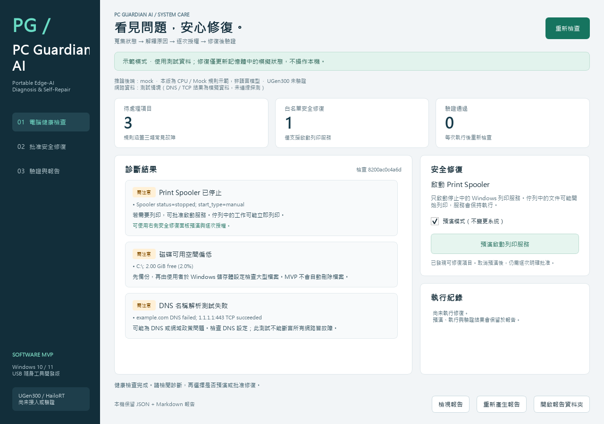

# PC Guardian AI

**Portable Edge-AI Computer Diagnosis & Self-Repair System**

A Windows 10/11 software MVP for evidence-based diagnosis and explicitly approved repair, prepared for the 2026 ASUS UGen AI League lightweight computing physical competition category.

**Current status:** CPU deterministic rules and a replaceable mock inference backend. No trained AI model runs in this MVP. UGen300/HailoRT integration, hardware acceleration and offline hardware repair are **not validated or implemented**. UGen300 is a host-connected USB accelerator; Windows remains responsible for permissions and repair execution.

[繁體中文完整說明](README.zh-TW.md) · [Validation record](docs/verification.md) · [Competition rules checked on 2026-10-13](docs/competition-rules.md)

## Quick start and demo materials

This repository contains the source code, tests, fixtures and bilingual documentation. Use **Code → Download ZIP** on GitHub, extract the archive and follow **Run from source** below. To build a portable Windows executable, run `Build-Windows.cmd`.

- [Narration and scene timeline](docs/PC-Guardian-AI-Demo-English-Script.md)
- [English subtitles](docs/PC-Guardian-AI-English-Subtitles.srt)
- [Validation record and limitations](docs/verification.md)



The video records the actual application using synthetic test fixtures. All repairs shown are simulated; the host service is unchanged. It uses English local synthetic narration, English captions and a Traditional Chinese application interface.

## Run from source

Requires 64-bit Python 3.11 or newer and Windows 10/11. Development and packaging were checked on Python 3.13. Dependencies are pinned in `constraints-windows.txt`.

```powershell
py -3 -m venv .venv
.\.venv\Scripts\python.exe -m pip install -e ".[test]" -c constraints-windows.txt
.\.venv\Scripts\python.exe -m app --demo
```

Alternatively, run `Setup.cmd`, then `Run-Demo.cmd`. `Run-Live.cmd` performs a local scan; live repair requires separate explicit approval and sufficient Windows privileges. External network probes are off by default.

## MVP workflow

1. Collect disk space, network interface state, Print Spooler state and Windows System Event Log observations.
2. Diagnose stopped Print Spooler, low disk space and DNS/connectivity test failures. Unknown data remains unknown.
3. Preview the allowlisted `start_print_spooler` action with dry-run enabled by default.
4. Require explicit approval for each execution. Cancelling does not execute a repair.
5. Verify the service state again and record before/after observations, errors and uncertainty.
6. Save JSON, readable Markdown and local JSONL audit records. Rescanning the demo after repair leaves the unresolved disk/DNS findings visible.

Disk cleanup and network configuration are manual recommendations. Starting the Spooler can resume queued print jobs. Verification only establishes that the service is running, not that a physical printer works.

## Safety boundaries

- No model-generated shell commands: backends return structured diagnosis/action IDs; trusted rules and policy restrict execution.
- Fixed subprocess argument lists, timeouts, no automatic elevation, fresh state/privilege checks and an audit intent before mutation.
- Demo mode is fixed by the application session and cannot mutate the host.
- Local audit logs are not tamper-proof or digitally signed. Review live reports before sharing; they may contain local system details.
- No real service was stopped or started to manufacture a demonstration. Real privileged repair across Windows versions still needs disposable VM acceptance testing.

## Architecture

```text
app/
  ui/                  PySide6 desktop interface
  collectors/          psutil, PowerShell and Windows Event Log
  ai/                  analyzer, mock backend, unavailable Hailo adapter
  diagnosis/           evidence-based rule engine
  repair/              policy, executor and verifier
  reports/             JSON / Markdown reports and audit logging
  knowledge/rules/     supported rules and synthetic demo data
tests/fixtures/        deterministic tests and fixtures
```

## Tests and packaging

```powershell
.\.venv\Scripts\python.exe -m pytest -q
```

Recorded validation: **63 tests and 7 subtests passed**, including eight GUI tests; portable CLI and offscreen GUI smoke checks passed. See [the detailed scope and limitations](docs/verification.md). Use `Build-Windows.cmd` to rebuild the portable application.

## Next milestones

Validate privileged repair in disposable Windows 10/11 VMs, broaden diagnostics while preserving explicit approval, then integrate and benchmark a supported model with the actual UGen300/HailoRT runtime. The future accelerator performs inference; it does not independently control Windows.
